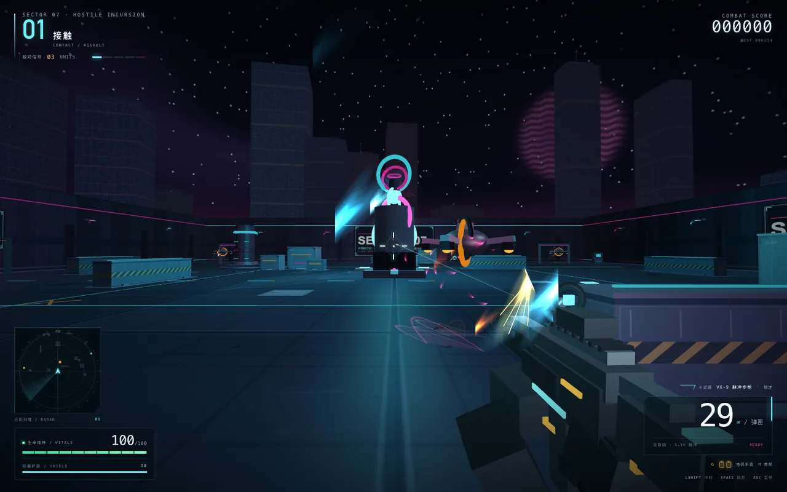

<div align="center">

# NEON BREACH

### 霓虹突袭

**一款完全由代码生成、零外部素材依赖的第一人称 3D 霓虹竞技场射击游戏。**

*Five waves. One arena. No dependencies.*

[**▶ 在线游玩**](https://norwinyu.github.io/neon-breach/) · [核心特性](#核心特性) · [操作方式](#操作方式) · [本地运行](#本地运行) · [部署到-github-pages](#部署到-github-pages)

<sub>仓库名：`neon-breach` · 原生 WebGL · 单文件构建 · 无需安装</sub>

<a href="https://norwinyu.github.io/neon-breach/">
  
</a>

<sub>游戏实机截图。在线地址在首次启用 GitHub Pages 后生效。</sub>

</div>

---

## 关于项目

**NEON BREACH / 霓虹突袭** 是一款运行在浏览器中的单人第一人称射击游戏。

你是最后一名「破界者」执行者。穿过被机械军团占领的零号竞技场，在五轮进攻中存活，并击破最终核心守卫——典狱长。

游戏的全部画面、模型、贴图、界面与音效均由代码实时生成。可玩的 `index.html` 是完整构建产物，不依赖外部图片、字体、音频、CDN 或 JavaScript 框架。

## 核心特性

- **完整五波战役**：侦察机、织网者、碾压者、哨戒炮轮番入场，最终迎战三阶段 Boss「典狱长」。
- **原生 WebGL 3D 渲染**：自写渲染管线、程序化几何、动态点光、雾、辉光粒子、弹道、枪口火焰与接触阴影。
- **有压迫感的敌人 AI**：A* 网格寻路、视线检测、侧向游走、预判射击、近身突袭、落点预警与阶段增援。
- **扎实的枪械手感**：全自动脉冲步枪、右键稳定瞄准、后坐力、动态准星、换弹、爆头暴击与命中反馈。
- **战术道具与 HUD**：电弧手雷、护盾再生、生命补给、旋转雷达、连击倍率、Boss 血条和低血量预警。
- **程序化音频**：Web Audio 实时合成枪声、机械音、爆炸、心跳与自适应节拍音乐。
- **完整游戏流程**：开始菜单、暂停、设置、最高分本地存档、失败与通关结算。
- **单文件游戏**：构建后的 `index.html` 自带全部运行时代码与程序化素材。
- **响应式界面**：适配桌面 1440p / 1080p / 720p 与较窄窗口。

## 操作方式

| 输入 | 动作 |
| --- | --- |
| `W` `A` `S` `D` | 移动 |
| 鼠标移动 | 瞄准 |
| 鼠标左键 | 射击 |
| 鼠标右键 | 稳定瞄准 |
| `R` | 更换弹匣 |
| `G` | 投掷电弧手雷 |
| `Shift` | 冲刺 |
| `Space` | 跳跃 |
| `M` | 静音 / 恢复音频 |
| `Esc` | 暂停 / 释放鼠标 |

> 建议使用桌面端键盘与鼠标，并佩戴耳机。若浏览器未授予鼠标锁定权限，游戏会自动切换到「移动鼠标瞄准 + 点击射击」的备用模式。

## 本地运行

直接打开 `index.html` 也可游玩。若浏览器对 `file://` 的鼠标锁定有限制，建议启动一个本地静态服务器：

```bash
# 在仓库根目录
python3 -m http.server 8080
```

然后访问 <http://localhost:8080/>。

## 开发与构建

游戏源码位于 `src/`，构建脚本只使用 Node.js 内置模块。修改源码后运行：

```bash
# 需要 Node.js 18+
node build.mjs
```

构建会把所有样式与脚本内联，生成新的 `index.html`。

```text
.
├── index.html              # 构建产物，GitHub Pages 入口
├── assets/
│   └── preview.webp        # README 游戏截图
├── src/
│   ├── shell.html          # HTML 外壳
│   ├── style.css           # HUD 与菜单样式
│   ├── 00-core.js          # 数学、输入、存档
│   ├── 10-gl.js            # WebGL 渲染器与着色器
│   ├── 20-world.js         # 竞技场与模型
│   ├── 30-audio.js         # 程序化音频
│   ├── 40-state.js         # 游戏状态与导航
│   ├── 45-viewmodel.js     # 第一人称武器
│   ├── 47-ui.js            # 菜单、HUD、输入
│   ├── 50-systems.js       # 战斗、敌人 AI、波次
│   └── 60-render.js        # 场景合成与主循环
├── build.mjs
├── package.json
├── .nojekyll
└── README.md
```

## 部署到 GitHub Pages

1. 在 GitHub 新建公开仓库 `neon-breach`。
2. 在仓库根目录初始化并推送：

```bash
git init
git add .
git commit -m "feat: release NEON BREACH"
git branch -M main
git remote add origin https://github.com/<your-github-username>/neon-breach.git
git push -u origin main
```

3. 打开仓库 **Settings → Pages**。
4. 在 **Build and deployment** 中将 Source 设为 **Deploy from a branch**，分支选择 `main`，目录选择 `/ (root)`。
5. 保存后等待部署完成，访问：

```text
https://<your-github-username>.github.io/neon-breach/
```

仓库已包含 `.nojekyll`，无需额外的构建步骤。如果启用了自定义域名，或修改了仓库名，请同步更新页面顶部的在线地址。

## 技术说明

- **渲染**：原生 WebGL 1.0，自写顶点/片元着色器和矩阵/几何管线，固定容量点光源，程序化 Canvas 纹理，加色辉光与屏幕空间叠加层。
- **AI 与导航**：动态代价网格、A* 寻路、视线射线、状态机、Boss 阶段与弹幕调度。
- **音频**：Web Audio 振荡器、噪声缓冲、滤波器和自动节拍；所有音效在运行时合成。
- **界面**：原生 HTML/CSS/DOM 与 Canvas 2D；无 UI 框架。
- **存档**：`localStorage` 保存设置与最高分；不收集、不上传任何数据。
- **测试环境**：Chrome，1440 × 900 与 1280 × 720；桌面 GPU 下以 60 FPS 为目标。

## 素材与隐私

- 游戏内所有模型、纹理、UI、音效与粒子均由代码程序化生成，不包含第三方素材。
- 仓库仅包含游戏源码、构建产物和一张游戏实机截图，不包含个人照片、私人文档或其他个人信息。
- 游戏运行时不发起网络请求、不采集遥测数据，也不需要登录。

## 兼容性

需要支持 WebGL 的现代桌面浏览器：Chrome、Edge、Safari 或 Firefox。当前版本不包含触屏操作，移动端仅可浏览界面；建议使用键盘和鼠标游玩。
